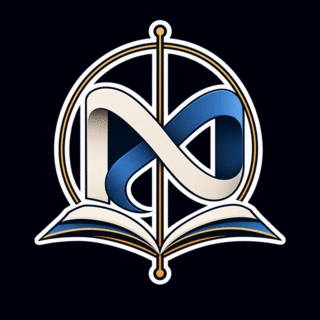

<p align="center">
  
</p>

# Drawmath

<div align="center">
  
  
  
  
</div>

Drawmath is a sleek mathematical drawing tool that turns abstract geometry into interactive visual creations. Built for students, teachers, and creators, it lets you sketch and manipulate shapes like rectangles, circles, lines, vectors, and polygons while instantly exposing equations, measurements, and geometric properties.

Live demo: https://drawmath.netlify.app/

## Why Drawmath?

From classroom geometry exercises to quick visual prototyping, Drawmath helps you:

- sketch geometric elements directly on a coordinate plane
- drag, resize, and transform shapes in real time
- inspect properties such as dimensions, equations, and intersections
- switch between drawing mode and matrix transformation mode
- export your work as PNG, SVG, or JSON

## Features

### Interactive geometry canvas
- draw points, lines, segments, rays, circles, ellipses, rectangles, squares, triangles, parabolas, sine curves, vectors, and polygons
- click-to-create and drag-to-place tools
- precise cursor tracking in world coordinates
- snap-to-grid support for cleaner constructions
- real-time measurement overlays

### Smart shape behavior
- resize handles and vertex manipulation for selected objects
- shape selection and multi-object interactions
- intersection detection between geometric elements
- live equations and annotations using KaTeX
- auto-save workspace state in the browser

### Matrix mode
- explore a 2×2 transformation workspace
- animate identity-to-target matrix transitions
- inspect transformation values and presets
- switch seamlessly between draw mode and matrix mode

### Export & workflow
- export drawings as PNG, SVG, or JSON
- import saved designs back into the app
- undo/redo support
- light/dark theme toggle
- responsive layout for desktop and mobile

### Motion & feedback
- ripple + press-down feedback on every button
- animated Draw ↔ Matrix workspace hand-off (the outgoing workspace fades and
  slides away while a light sweep crosses the canvas)
- sliding indicator in the Draw / Matrix switch
- live mode chip in the status bar
- `M` toggles between the Draw and Matrix workspaces
- honours the OS "reduce motion" preference

## Tech Stack

- React + TypeScript
- Vite
- Zustand for app state
- KaTeX for mathematical rendering
- custom geometric engine for shape logic and calculations

## Getting Started

### Prerequisites

- Node.js 18+
- npm

### Installation

```bash
git clone https://github.com/Pawanraje-kadam/Drawmath.git
cd Drawmath
npm install
```

### Run locally

```bash
npm run dev
```

Then open the local Vite URL shown in your terminal (typically http://localhost:5173).

### Production build

```bash
npm run build
```

To preview the production build:

```bash
npm run preview
```

## Project Structure

```text
Drawmath/
├── index.html
├── package.json
├── tsconfig.json
├── vite.config.ts
├── netlify.toml
├── src/
│   ├── App.tsx
│   ├── components/
│   ├── engine/
│   ├── hooks/
│   ├── store/
│   ├── styles/
│   ├── types/
│   └── main.tsx
├── LICENSE
├── .gitignore
└── README.md
```

## Usage Tips

- Start by selecting a tool from the toolbar and dragging it onto the canvas.
- Click a shape to select it, then use the inspector to adjust properties.
- Toggle snapping for cleaner alignment and measurements.
- Use the Matrix mode to visualize transformations and compare them with the identity matrix.
- Press `M` at any time to jump between the Draw and Matrix workspaces.
- Export your design as SVG or PNG when you want to share or present it.

## License

This project is licensed under the MIT License. See the [LICENSE](LICENSE) file for details.

## Contributing

Contributions are welcome. If you want to improve the geometry engine, add new shapes, or refine the UI:

1. fork the repository
2. create a feature branch
3. make your changes
4. open a pull request

## Acknowledgements

Thanks to everyone building interactive math tooling and geometry education experiences. Drawmath aims to make mathematical visualization more intuitive, expressive, and accessible.

---

Made with care for exploring geometry, equations, and transformations.
